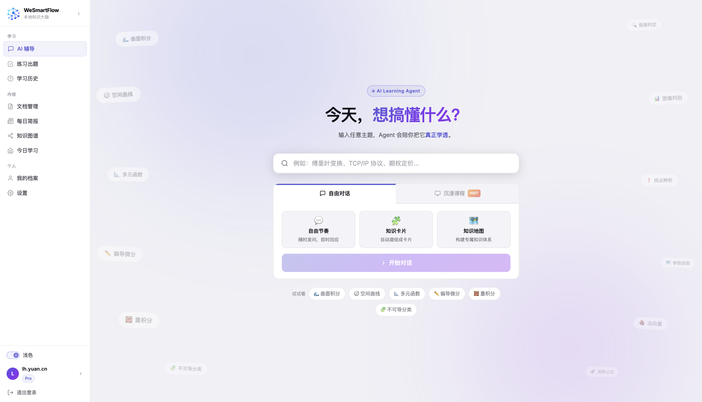
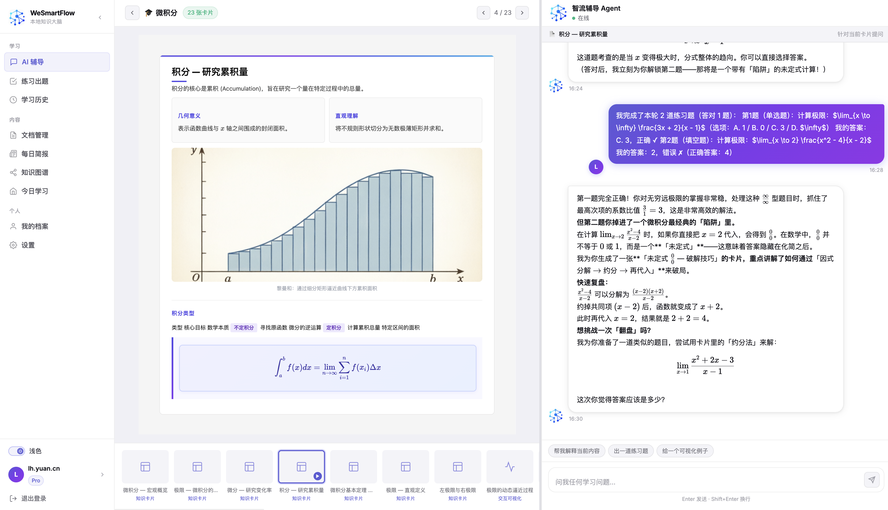
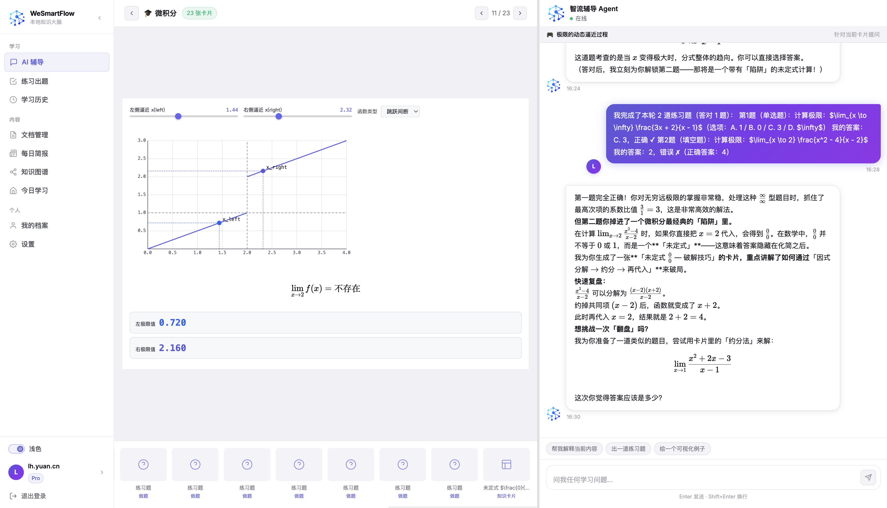
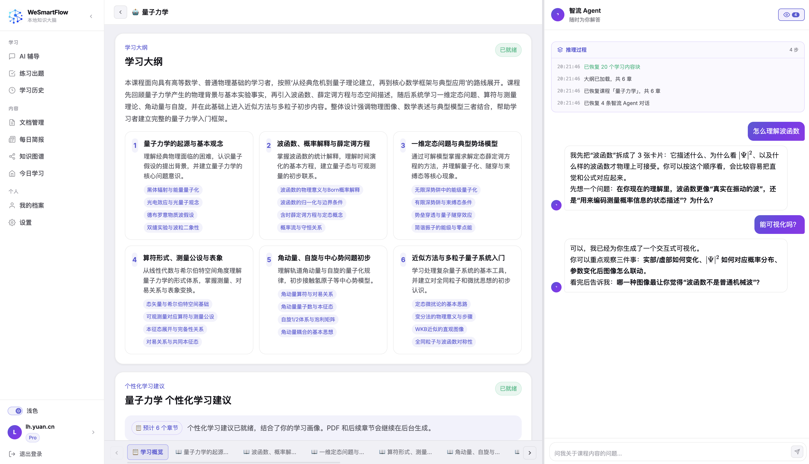
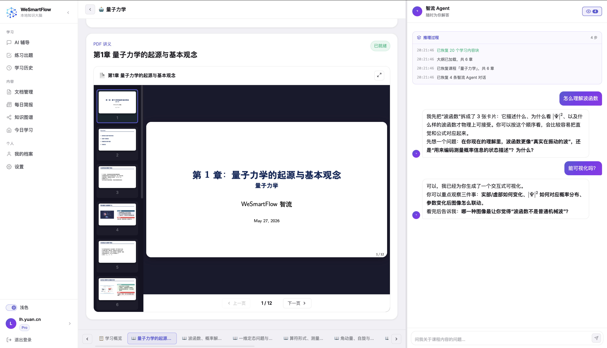
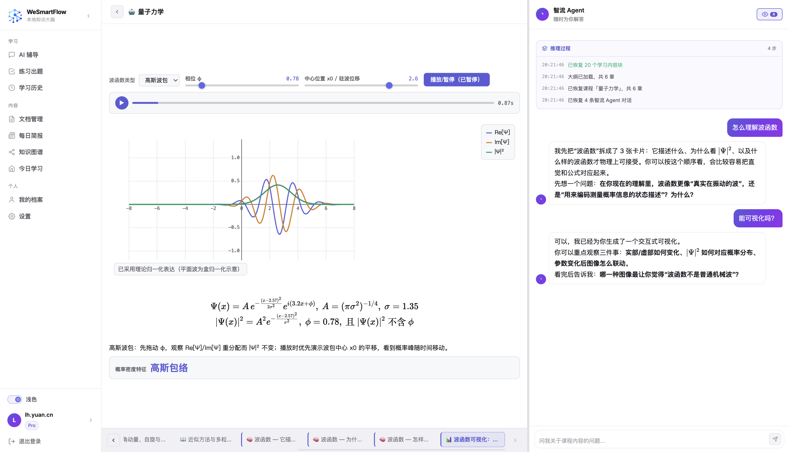

<div align="center">

# WeSmartFlow

**An agent-native learning framework for questions, courses, interactive worlds, and long-term memory.**

[](https://www.python.org/downloads/)
[](https://vuejs.org/)
[](https://fastapi.tiangolo.com/)
[](./LICENSE)

WeSmartFlow is an open-source, agent-native adaptive learning framework.<br/>
It understands learning goals, plans the next steps, supports practice, and records progress in a personal Knowledge Brain.

[Try it online](http://wesmartflow.cn) · [Explore](#3-explore-a-world-designed-for-learning) · [Quick start](#-quick-start) · [Publish a course](#publish-your-course) · [中文](./README.md)

**🎁 Sign up with GitHub or email to receive 5 million free credits; [star the project on GitHub](https://github.com/Tencent/WeSmartFlow) and verify your Star to claim another 5 million credits**

</div>

---

## 📮 Updates

> Major WeSmartFlow updates are listed here in reverse chronological order.

### 2026.08.31 · Free access program

Sign up with **GitHub or email** to receive **5 million free credits** for tutoring, immersive courses, the Knowledge Brain, and Explore. Star the [WeSmartFlow GitHub repository](https://github.com/Tencent/WeSmartFlow) and verify your Star through your linked GitHub account to claim **another 5 million credits**, for a total of **10 million credits**. Each user account and GitHub account can claim the Star reward only once.

Starting the following month, receive up to **1 million credits per month**, topping up your balance to **5 million credits**. No monthly top-up is added while your balance is at or above 5 million. How long your credits last depends on the selected model, learning frequency, and response length.

**How to claim it:** Sign up and sign in at [wesmartflow.cn](http://wesmartflow.cn) to receive your signup credits → [star the repository](https://github.com/Tencent/WeSmartFlow) → open the credits section in Settings and choose the option to link GitHub and claim, or verify and claim, to receive the extra reward.

### 2026.08 · Explore: learning beyond the chat window

Explore has been redesigned around interactive learning worlds.

Start with English, science, mathematics, or history, then enter a world with its own characters, rules, and tasks. Courses can take the form of continuous stories, explorable maps, open-ended experiments, hands-on games, historical simulations, narration, or animation. [See the available experiences](#3-explore-a-world-designed-for-learning).

## 🌱 Why WeSmartFlow

Learning rarely moves in a straight line.

People get curious, get stuck, try again, forget, and sometimes understand everything in a single moment. A useful learning companion should know what is already clear, what still feels uncertain, what to do next, and when an idea is worth revisiting.

WeSmartFlow supports that process in five ways:

- **Understand the goal:** keep track of what the learner wants to achieve and where they are now
- **Support practice:** use explanations, follow-up questions, cards, visualizations, and quizzes
- **Remember progress:** save concepts, connections, and mastery changes in a personal Knowledge Brain
- **Adapt the path:** decide when to go deeper, change the explanation, or schedule a review
- **Create context:** place knowledge inside stories, experiments, and meaningful tasks

## 🎒 Ways to Learn

### 1. Open tutoring: start with a question

Begin with any question. The Agent can create a knowledge card, an interactive demonstration, or a short quiz when useful, then record the new understanding in the Knowledge Brain.

<p align="center">
  
  
  
</p>

### 2. Immersive courses: study a topic from beginning to end

Enter a topic and a group of Agents will research it, plan the chapters, and prepare slides, illustrations, narration, and exercises. Follow the outline at your own pace and pause to ask questions whenever you need.

<p align="center">
  
  
  
</p>

### 3. Explore: a world designed for learning

Choose a subject in Explore and learn through character conversations, world exploration, open experiments, hands-on games, or historical simulations. Every course can define its own visuals, audio, characters, map, and progression rules. Course creators shape how the world works; WeSmartFlow helps people discover and launch it, with shared Agent and backend capabilities available when needed.

#### Available experiences

| Experience | How it works |
|------------|--------------|
| **Magic English Town** | Speak English with Agent characters while finding clues, making friends, and creating stories |
| **Math Garden** | Build with blocks, inspect orthographic views, and solve expression-cannon challenges |
| **BingeMate** | Learn expressions, cultural references, connected speech, and reductions through real TV scenes |
| **Chemistry Lab** | Combine materials and reaction conditions freely, then ask the Agent to evaluate and explain the result |
| **Realm of Knowledge** | Return to moments in the history of science, meet scientists, and recreate classic experiments |
| **Generated Worlds · History** | Turn a historical period into a living world of debate, inquiry, evidence, and counterfactuals |

These six experiences are a starting point. Teachers, developers, and course creators are welcome to publish their own work, keep their design and technology choices, and develop ideas together with the community.

#### Example: Magic English Town

**Magic English Town** is designed for learners aged 8–16. Learners can use voice or keyboard to speak with characters while looking for a missing puppy or preparing a moonlight festival. The Agent interprets learner input and writes character responses, while a local state machine manages locations, tasks, rewards, and completion rules.

### 4. Knowledge Brain: see your understanding take shape

Every learning session leaves a useful trace. The Knowledge Brain turns what you learn into growing knowledge particles and records relationships between concepts, current mastery, and the next review date, giving learners a clear view of their progress.

<p align="center">
  
</p>

## 🧠 Core Capabilities

### ReAct Agent for personalized tutoring

The tutoring Agent calls focused educational tools during a conversation, with each tool handling a specific task:

| Capability | What it does |
|------------|--------------|
| Knowledge node creation and updates | Identifies new concepts and maintains descriptions, tags, and relationships |
| Mastery updates | Adjusts mastery for the relevant knowledge node based on learning performance |
| HTML knowledge cards | Organizes key ideas into clear, reusable learning cards |
| EduViz interactive visualization | Explains abstract ideas through animation, parameters, and manipulable objects |
| Instant quizzes | Creates multiple-choice, fill-in-the-blank, true/false, and open-ended questions with feedback |
| Graph search | Retrieves previously learned material and connects it to the current topic |
| Multi-source search | Uses Tavily, arXiv, and DuckDuckGo to gather supporting material |
| Voice explanation | Generates audio explanations in supported environments |

### Graph Memory — personal Knowledge Brain

- **Mastery tracking:** `mastery_level` records changes in mastery for each knowledge node
- **Four relationship types:** prerequisite / related / extends / contrasts
- **Spaced repetition:** SM-2 parameters schedule future reviews
- **Shared across experiences:** open tutoring and immersive courses use the same personal graph
- **Learner profile memory:** long-term interaction builds a record of preferences and background

### Multi-Agent course generation

```text
A learning topic
  │
  ├── Planning Agent      ── defines chapters and the learning path
  ├── Research Agent      ── gathers and organizes sources
  ├── Writing Agent       ── prepares chapter slides
  ├── Illustration Agent  ── creates supporting images
  ├── Voice Agent         ── generates narrated explanations
  └── Quiz Agent          ── prepares exercises and feedback
  │
  └── PDF + audio + exercises + Knowledge Brain nodes
```

### HTML knowledge cards and EduViz

Use **HTML cards** for a focused explanation: a formula, a comparison, worked steps, or an illustration. Use **EduViz** when changing a parameter, stepping through an algorithm, or observing motion helps explain the concept.

Both tools stream their generation progress in tutoring conversations and register successful results as documents, optionally linked to knowledge nodes. HTML cards use shared layout components; EduViz generates JavaScript against the SDK, checks it, and requests targeted repairs when needed. Browser checks help catch runtime problems, while a model reviews core correctness; passing these checks does not certify visual or teaching quality.

Implementation, dependencies, validation rules and troubleshooting are covered in the [backend guide](./backend/README_EN.md#content-generation-tools).

### WeClaw WeChat Assistant Integration

> Bring the learning assistant into WeChat — study anytime, anywhere.

edu-agent can act as a message channel that plugs into **WeClaw (WeChat clawbridge)**, so conversations in WeChat are answered directly by your AI learning assistant:

- **QR-code binding** — Bind your WeChat bot to your account by scanning a QR code on the "WeChat Assistant" page (each user binds their own bot)
- **Multi-tenant long polling** — One async httpx long-polling coroutine per bot (≈ one idle long connection instead of a thread), scheduled by a ChannelManager; a single machine can host many online bots
- **Shared reasoning brain** — WeChat messages go straight through `TutorService`, sharing the same ReAct tutoring capabilities, Knowledge Brain, and user profile as the web app
- **Cards as images** — HTML knowledge cards / interactive visualizations / quiz cards are rendered into images via a headless browser (Playwright) and sent as pictures, with a link back to the web app for interaction

## 🛠️ For Developers

WeSmartFlow is also a reusable engineering framework for educational Agents. General Agent capabilities, education services, the web application, and standalone learning experiences live in separate layers:

<p align="center">
  
</p>

| Layer | Path | What belongs here |
|-------|------|-------------------|
| Agent core | [`backend/agent_core/`](./backend/agent_core/) | ReAct, DAG workflows, tools and MCP, skills, context assembly, session memory, and runtime budgets |
| Backend services | [`backend/`](./backend/) | FastAPI routes, educational Agents, the knowledge graph, and immersive course workflows |
| Frontend application | [`frontend/`](./frontend/) | Tutoring, courses, graph, quizzes, and the Explore portal |
| Explore experiences | [`examples/`](./examples/) | Standalone learning worlds built with any suitable frontend technology |
| WeChat interfaces | [`miniprogram/`](./miniprogram/) · [`backend/channels/`](./backend/channels/) | Native mini program and WeClaw messaging, reusing backend learning services |
| Shared knowledge graph | [`backend/kg/`](./backend/kg/) | Graph RAG, observations, and proposal review through `kg_facade`, separate from personal learning state |

### Connect a new learning world to Explore

Explore experiences remain loosely coupled from the portal. A course can be built independently with Vue, React, Svelte, Canvas, Three.js, or plain HTML. It can be a complete course, a small experiment, an interactive story, or a new teaching format.

The portal and an experience share three stable contracts:

```text
Content contract: examples/explore-catalog.json
Build contract:   build:wesmartflow + environment variables
Service contract: same-origin static path + optional relative /api paths
```

Adding an experience usually takes four steps:

1. Create a standalone application under `examples/`.
2. Provide a `build:wesmartflow` script.
3. Register its category, entry point, and presentation content in `examples/explore-catalog.json`.
4. Validate the catalog and run the integrated build.

```bash
cd frontend
npm run validate:examples
npm run build:examples -- --only your-topic-id
```

See the [Explore experience development guide](./examples/README.md) for the full schema, path, and build conventions.

### Publish your course

Explore is open to anyone who cares about making a thoughtful course.

There is no prescribed subject, age group, visual style, or interaction pattern. Extend an existing world or bring a completely new one. When it is ready, register the course in `explore-catalog.json` and open a Pull Request. We will review the build, entry point, basic usability, and learning experience before adding it to Explore.

Author attribution appears with the course. Course creators keep their code structure, design language, and preferred process for future updates.

## 🚀 Quick Start

### Requirements

The repository's Conda environment is the recommended setup. It installs Python, Node.js, and the backend dependencies.

Generating immersive PDF courseware also requires XeLaTeX, `latexmk`, and the [SimplePlus Beamer Theme](https://github.com/pm25/SimplePlus-BeamerTheme).

### 1. Clone the repository

Install Git and Git LFS first. The repository tracks PNG and MP4 assets through [Git LFS rules](./.gitattributes); `git lfs pull` retrieves their full contents.

```bash
git lfs install
git clone https://github.com/Tencent/WeSmartFlow.git
cd WeSmartFlow
git lfs pull
```

### 2. Install dependencies

```bash
conda env create -f environment.yml
conda activate agent

npm --prefix frontend install --include=dev

# Required for EduViz browser checks and WeClaw card screenshots
python -m playwright install chromium

# Two Explore experiences currently use Vite and need their own install once
npm --prefix examples/Magic_English_Town install
npm --prefix examples/chemastry_lab install
```

For a setup without Conda, install Python 3.10+, Node.js 24+ (the Conda environment currently uses Node.js 25), and the packages in `backend/requirements.txt`.

### 3. Configure the model and sign-in method

```bash
cp backend/.env.example .env
```

Edit `.env` in the repository root. The learning Agent needs at least:

```bash
LLM_API_KEY="your-api-key"
LLM_BASE_URL="https://your-openai-compatible-endpoint/v1"
LLM_MODEL="your-model"
```

OpenAI, DeepSeek, Qwen, and other OpenAI-compatible endpoints can be used. Configure at least one sign-in method: GitHub OAuth, email via SMTP, or WeChat Mini Program. Search, image generation, and voice features can be enabled as needed. See [`backend/.env.example`](./backend/.env.example) and the [backend documentation](./backend/README_EN.md) for all available settings.

Security defaults:

- When `JWT_SECRET` is empty, the backend generates a random master key and stores it in `data/jwt_secret.key` (mode 0600). Set an explicit random value in `.env` for production and back up the file. Legacy example values such as `change-me-in-production` abort startup.
- The backend listens on `127.0.0.1` by default. Set `BACKEND_HOST=0.0.0.0` explicitly behind a reverse proxy/firewall when external access is required.
- The admin console requires explicit `ADMIN_USERNAME` / `ADMIN_PASSWORD`; all `/api/admin` routes return 503 when unset.

### 4. Start the backend and frontend

```bash
# Terminal 1: backend on port 8080
cd backend
python main.py
```

```bash
# Terminal 2: frontend on port 5173
cd frontend
npm run dev
```

Open `http://localhost:5173`. The backend health endpoint is `http://localhost:8080/health`, and Explore is available at `http://localhost:5173/#/explore`.

> `npm run dev` first builds the local experiences registered in `explore-catalog.json`. The Explore page components stay unchanged when a new experience is added.

### Enable WeClaw WeChat Assistant (optional)

To plug the learning assistant into WeChat, a few extra steps are needed:

**1. Ensure Chromium is installed in the backend Python environment**

```bash
python -m playwright install chromium
```

**2. Configure environment variables** (repository-root `.env`)

```bash
WECLAW_ENABLED=true                    # enable the WeClaw channel
PUBLIC_BASE_URL=https://your-domain    # public base URL for card/slide links
# WECLAW_RENDER_CARDS=true             # render cards as images (on by default)
```

**3. Bind via QR code**

After restarting the backend, log into the web app and open the **"WeChat Assistant"** page → click "Start Binding" → scan the QR code with WeChat. Once bound, messages received by that WeChat bot are answered by your AI learning assistant.

| Variable | Description | Default |
|----------|-------------|---------|
| `WECLAW_ENABLED` | Enable the WeClaw channel | `false` |
| `PUBLIC_BASE_URL` | Public base URL (card/slide links) | empty |
| `WECLAW_RENDER_CARDS` | Render cards as images | `true` |
| `WECLAW_RENDER_WIDTH` | Screenshot viewport width (px) | `480` |

> Note: HTML cards / visualizations / quizzes are rendered as images with a link back to the web app for interaction; PDF slides are sent as links.

### Enable immersive PDF courseware (optional)

```bash
# macOS
brew install --cask mactex-no-gui

# Ubuntu / Debian
sudo apt install texlive-xetex texlive-latex-extra texlive-fonts-extra \
                 texlive-lang-chinese latexmk

git clone https://github.com/pm25/SimplePlus-BeamerTheme.git backend/SimplePlus-BeamerTheme
```

## Developer documentation and checks

| Guide | Contents |
| --- | --- |
| [Backend](./backend/README_EN.md) | Setup, API contracts, content generation, validation and troubleshooting |
| [Frontend](./frontend/README_EN.md) | Build commands, routes, streaming UI and iframe rendering |
| [Agent core](./backend/agent_core/README_EN.md) | ReAct, tool registration, contexts and runtime budgets |
| [Explore](./examples/README.md) | Catalog, independent applications and integration builds |

Run these commands from the repository root, using the installed Python and Node environments:

```bash
# Install test-only dependencies
python -m pip install pytest
# Fixed fixtures; no paid model calls
python -m pytest backend/tests/test_html_card.py backend/tests/test_viz_quality.py backend/tests/test_viz_streaming.py -q
# Requires Chromium; exercises actual rendering and interaction
RUN_VIZ_BROWSER_TESTS=1 python -m pytest backend/tests/test_viz_runtime.py -q
# Validate the Explore catalog
npm --prefix frontend run validate:examples
```

Keep the frontend SDK source and development dependencies available to the backend: EduViz uses both the SDK and ESLint during generation. See the [backend guide](./backend/README_EN.md#troubleshooting) for missing-browser, lint and rendering failures.

## 🧩 Project Structure

```text
WeSmartFlow/
├── backend/
│   ├── agent_core/          # General-purpose Agent core
│   ├── agents/              # Educational Agents, tools, and prompts
│   ├── services/            # Tutoring, courses, and knowledge graph services
│   ├── channels/            # WeClaw WeChat channel (QR login / long polling / card rendering)
│   ├── routers/             # FastAPI routes and Explore API adapters
│   ├── repositories/        # Data access layer
│   ├── models/              # Data models
│   └── main.py              # Backend entry point
├── frontend/
│   ├── src/views/           # Chat / Immersive / Graph / Quiz / Explore
│   ├── src/components/      # Cards, quizzes, EduViz, and shared components
│   └── public/              # Built Explore experience assets
├── examples/
│   ├── explore-catalog.json # Explore content and build catalog
│   ├── build.mjs            # Integrated build orchestrator
│   └── */                   # Independent interactive learning experiences
├── environment.yml
└── README.md
```

## 🔧 Technical Design and Engineering Direction

WeSmartFlow favors technologies that are easy to understand and replace. Shared capabilities live in `agent_core`, education-specific work stays in the service layer, and Explore courses build independently. Models, search, image generation, and messaging channels connect through explicit interfaces.

| Layer | Technologies |
|-------|--------------|
| Frontend | Vue 3 · Vue Router · Vite · Three.js · KaTeX · pdf.js |
| Backend | FastAPI · SQLite (WAL) · sqlite-vec · Pydantic · Uvicorn |
| Agent | Custom `agent_core` · ReAct · DAG workflows · Tool Use · Agent-as-Tool · MCP |
| Models | OpenAI-compatible protocol with support for different models and gateways |
| Content | HTML knowledge cards · EduViz · XeLaTeX / Beamer · TTS |
| Message Channel | WeClaw WeChat integration (clawbridge long polling · async httpx coroutine pool · Playwright card rendering) |
| Search | Tavily · arXiv · DuckDuckGo |
| Authentication | GitHub OAuth · Email verification · WeChat Mini Program · JWT |

Engineering work follows three directions: educational-task evaluation, Reflection, and execution tracing for more reliable results; a broader MCP tool ecosystem, multi-model routing, parallel Agents, and layered memory for greater flexibility; and PostgreSQL, object storage, vector retrieval, and containerized deployment for durable production services. New capabilities follow the existing layer boundaries and move into the main architecture as they mature.

## 🤝 Build with Us

WeSmartFlow is growing, and we would especially love to see courses from the community: an interactive story, a science experiment, a mathematics garden, or a learning format we have not encountered yet can become the next entry in Explore.

Issues and Pull Requests are also welcome for Agent improvements, new tool integrations, and feedback from real use. If you plan to publish an Explore course, start with the [Explore experience development guide](./examples/README.md); it explains how to keep an experience independent while connecting it cleanly to WeSmartFlow.

## 📄 License

This project is released under the [MIT License](./LICENSE).
